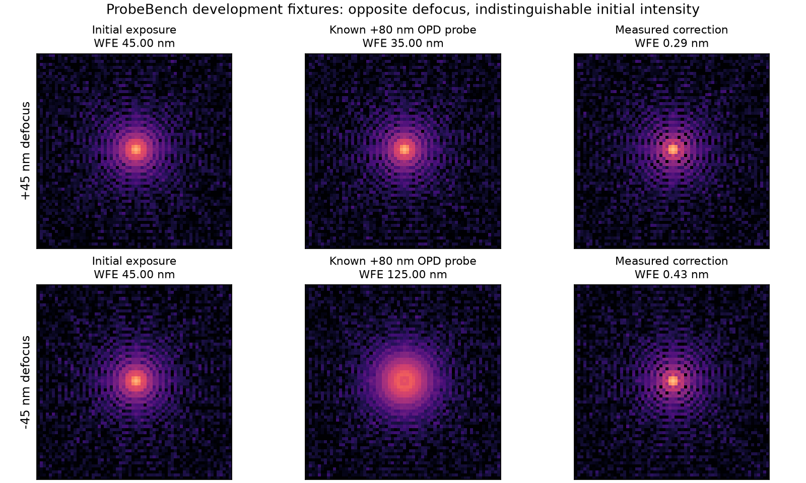

# ProbeBench

**Sequential optical calibration under a photon budget.**

ProbeBench is a simulation environment for studying how optical controllers choose
measurements. A controller receives noisy focal-plane images, applies bounded phase
corrections, and submits a final command. Every exposure consumes photons. The evaluator
tracks correction quality, measurement cost, and temporary degradation during probing.

The starting problem is simple: opposite wavefront errors can produce indistinguishable
images. A useful probe can make an image worse while revealing how to correct it.



*Recorded synthetic exposures from the four-fixture development demonstration.*

## Quick start

Requires Python 3.11 or 3.12 and [uv](https://docs.astral.sh/uv/).
The experiment runners use POSIX file locking; use Linux or macOS.

```sh
git clone https://github.com/noetherlabs/probebench.git
cd probebench
uv sync --locked --extra dev

# Verify the retained demonstration.
uv run --locked python -m probebench.run --verify results/development-20261014

# Run a new four-policy comparison and verify its artifacts.
uv run --locked python -m probebench.run --output work/ambiguity
uv run --locked python -m probebench.run --verify work/ambiguity
```

Use a new output directory for each experiment. Completed runs are not overwritten.
For contribution checks, run `uv run --locked python -m pytest -q`.

## What you can study

- **Measurement selection:** compare unprobed, fixed-diversity, and adaptive acquisition
  with a shared estimator.
- **Calibration under noise:** compare least-squares and Poisson-Gaussian estimation
  using the same acquired images.
- **Resource tradeoffs:** measure residual wavefront error against photon and exposure
  allowances, including the cost of probes that temporarily worsen the optical state.
- **Agent interfaces:** test direct optical actions or tool-assisted estimation through
  a validated JSON protocol, with separate exposure, request, and solver allowances.

Runs retain raw signed detector arrays, applied commands, evaluator records, optimizer
diagnostics, source snapshots, and content hashes. Interrupted sequential experiments
can resume from saved exposures when source, configuration, and runtime match.

## Retained experiments

| Experiment | Recorded evidence | Question |
| --- | --- | --- |
| [Optical ambiguity](results/development-20261014/report.md) | 16 episodes across four policies and four fixtures | Can a known probe distinguish opposite defocus? |
| [Noise qualification](results/noise-qualification-20261014/report.md) | 24 acquisitions and 48 selected estimates | How does the likelihood affect calibration under detector noise? |
| [Sequential calibration](docs/sequential-calibration-results.md) | 192 episodes and 1,632 exposures | How does correction change with the exposure allowance? |
| [Measurement schedules](docs/measurement-schedule-results.md) | 192 episodes and 624 exposures | What changes when acquisition is fixed or adaptive? |
| [Classical reference selection](docs/parameter-selection-results.md) | 4,032 episodes and 30,912 exposures across 12 independent bases | Which single setting should each classical family use across the declared tuning cells? |

These are public development and tuning data. They are not held-out evaluations or evidence of
hardware performance. Reports retain non-winning outcomes and numerical failures.

## Run sequential calibration

```sh
uv run --locked python -m probebench.sequential \
  --config configs/sequential_calibration_development.json \
  --output work/sequential-calibration
uv run --locked python -m probebench.sequential --verify work/sequential-calibration
```

Add `--resume` to the acquisition command to continue an interrupted run. See the
[sequential protocol](docs/sequential-calibration.md) for policies and accounting, and
[reproducibility](docs/reproducibility.md) for execution from archived source.

The [artifact guide](docs/artifact-formats.md) covers figures, an offline measurement
replay, and ImageFolder exports that preserve raw signed detector values. The separate
classical-selection exporter retains every candidate in a `public_tuning` split, with
a portable replay for inspecting its measured trajectories and final-command status.

## Model and scope

The current model uses scalar monochromatic Fourier propagation at 550 nm, a circular
pupil, and six controlled modes: defocus, two astigmatisms, two comas, and spherical
aberration. Commands are nanometres of optical path difference. Detector measurements
combine Poisson photoelectron counts with Gaussian read noise.

Current experiments assume a static wavefront and an exactly matched optical model.
They do not establish robustness to model mismatch, telescope performance, or
language-model competence. The original three-exposure coordinate baseline probes
only defocus; the sequential runner completes a six-mode sweep at 13 exposures.
A final correction can be scored by the evaluator without a camera exposure at that
command. Reports distinguish those scores from measured images.

The policy interface separates observations from evaluator state; it is **not a sandbox
for untrusted Python**. Artifact hashes establish consistency, not authenticity.
Read [SECURITY.md](SECURITY.md) before executing policies or processing external archives.

## Documentation

- **Physics:** [optical model](docs/optical-model.md), [noise likelihood](docs/noise-likelihood.md).
- **Experiment design:** [measurement schedules](docs/measurement-schedule-ablation.md),
  [wavefront cohorts](docs/wavefront-cohorts.md), [parameter selection](docs/parameter-selection.md),
  [paired curve analysis](docs/paired-curve-analysis.md).
- **Agents:** [JSON protocol](docs/agent-protocol.md), [local vision-model adapter](docs/local-model-adapter.md).
- **Development:** [contributing](CONTRIBUTING.md), [changelog](CHANGELOG.md).

The completed v1 tuning study freezes six classical reference settings; its
[results](docs/parameter-selection-results.md) retain every candidate and numerical outcome.
Reserved evaluation is not implemented. Agent integration tests qualify the interface,
not the performance of a language model.

Built by [Noether Labs](https://www.noether.one/).

## License

Licensed under the [Apache License 2.0](LICENSE). See [NOTICE](NOTICE) for attribution.
