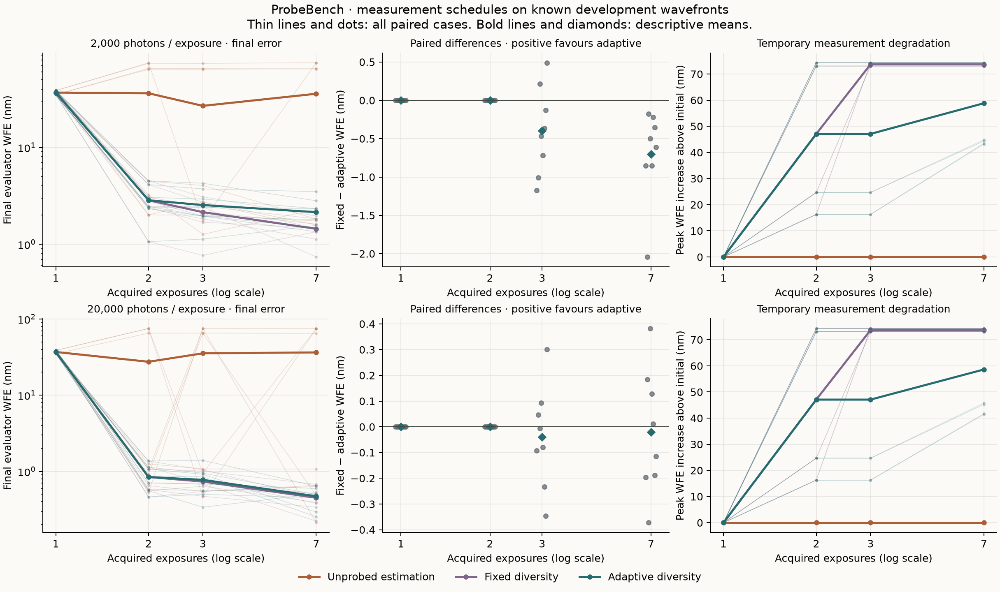

# ProbeBench: fixed probes, adaptive probes, and ambiguous fits

Noether Labs · 2026 · Development experiment

At seven exposures, a fixed phase-diversity sequence achieved lower mean final error
than the adaptive sequence in this comparison. The adaptive sequence caused less
temporary degradation. Both used the same likelihood, optical calibration and
per-fit solver allowance. The distinction was how they acquired their measurements.

A third method acquired every image without applying a probe. Its numerical fits
converged, but convergence did not identify the physical wavefront. At seven exposures,
eight of its sixteen submitted corrections were closer to the conjugate alternative
than to the true phase.

## Holding inference constant

We retained 192 episodes and 624 exposures: three schedules, four known mixed-mode
wavefronts, two detector replicates, two photon levels and allowances of 1, 2, 3 and
7 exposures. The wavefronts form two conjugate pairs. The plant is static and
monochromatic, with six controlled aberration modes and a circular pupil. Detector
measurements contain Poisson photon noise and one-electron Gaussian read noise.

The fixed schedule repeats defocus commands of 0, +80 and −80 nm OPD. The adaptive
schedule begins with 0 and +80 nm, then alternates estimated corrections with defocus
probes about its latest estimate. The unprobed schedule keeps the command at zero.
All three fit the same Poisson–Gaussian likelihood. At one exposure, all abstain and
submit zero; this experiment does not evaluate single-frame phase retrieval.



The table reports mean final evaluator WFE at seven exposures. Each entry includes
all eight fixture/noise cases at that photon level.

| Expected photons per exposure | Total expected photons | Fixed diversity (nm) | Adaptive diversity (nm) | Unprobed estimation (nm) |
| ---: | ---: | ---: | ---: | ---: |
| 2,000 | 14,000 | 1.4428 | 2.1438 | 35.8526 |
| 20,000 | 140,000 | 0.4506 | 0.4713 | 36.3887 |

At 2,000 photons per exposure, fixed diversity had lower error in all eight paired
seven-exposure cases. At 20,000 photons, each schedule had lower error in four cases.
The smaller mean difference at the brighter setting therefore does not describe a
consistent individual advantage. Every difference appears in the middle panels and
the [machine-readable analysis](../results/measurement-schedule-analysis-20261014/analysis.json).

The fixed schedule's mean peak WFE increase above the initial wavefront was
73.6926 nm at seven exposures. Adaptive acquisition reduced that mean to 58.8240 nm
at the lower photon level and 58.6073 nm at the higher level. The final-error ranking
and the temporary-degradation ranking consequently favour different schedules.
The adaptive method also performed six fits per seven-exposure episode, compared
with one for each fixed schedule. Equal measurement budgets did not imply equal
computation.

## An accurate fit to the wrong correction

For a real symmetric pupil, conjugate inversion of the pupil phase preserves the
unprobed intensity. In this basis, it negates defocus, both astigmatisms and spherical
aberration while preserving coma. More unprobed photons can improve the estimate
within this equivalence class without choosing its physically correct member.

At seven exposures and 20,000 photons per exposure, the unprobed method's mean error
modulo conjugacy was 0.5484 nm, while its actual correction error was 36.3887 nm.
Four of those eight corrections selected the wrong member. At the lower photon
level, the corresponding errors were 1.7308 nm and 35.8526 nm, again with four wrong
members. Modulo-conjugacy error is an evaluator diagnostic, not the correction score.

Across all 64 unprobed episodes, the largest difference between the true and conjugate
likelihoods was 8.882×10⁻¹⁶ per expected photon. This numerical check agrees with the
model's symmetry; it is not a statistical test for identifying the true member.

## Evidence and interpretation

All 240 selected fits and 720 optimizer starts reported convergence. Fixed and adaptive
acquisition returned identical images and corrections in the 32 paired cases with one
or two exposures, where their schedules coincide. A separate check verified 288 exact
image/command prefix matches across 48 policy/fixture/noise/photon groups.

The [protocol](measurement-schedule-ablation.md) and acquisition source were frozen at
commit `4fc6822` before collection. The [raw archive](../results/measurement-schedule-20261014/),
[generated tables](../results/measurement-schedule-analysis-20261014/report.md),
[prefix audit](../results/measurement-schedule-prefixes-20261014.json) and their hashes
are retained. Submitted corrections generally lack a final camera exposure; their
WFE and Strehl are computed independently by the evaluator.

A local ImageFolder export loaded all 624 images with Hugging Face Datasets. Every
signed detector array matched its source exactly, preserving 1,122,478 negative
read-noise samples. The [loading check](../results/measurement-schedule-imagefolder-validation-20261014.json)
records both photon levels and all three methods; [export instructions](artifact-formats.md)
describe the format.

These are four previously published development wavefronts with an exactly matched
plant and estimator. Shared noise streams and nested budgets are correlated. The
comparison does not establish a universally preferred schedule, performance on unseen
aberrations, robustness to calibration error, or multimodal-agent capability. It does
show why fixed experimental-design references, temporary probe cost and ambiguity
checks belong beside the final correction curve.

## Citation

```bibtex
@misc{noetherlabs2026probebenchschedules,
  title = {ProbeBench: Fixed Probes, Adaptive Probes, and Ambiguous Fits},
  author = {{Noether Labs}},
  year = {2026},
  url = {https://www.noether.one},
  howpublished = {Development experiment; code and retained data at https://github.com/noetherlabs/probebench}
}
```
