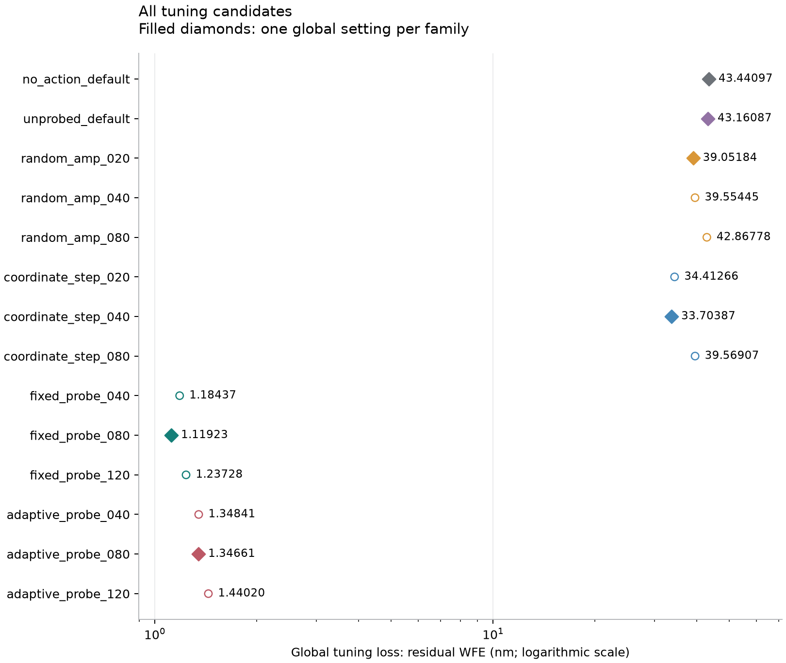
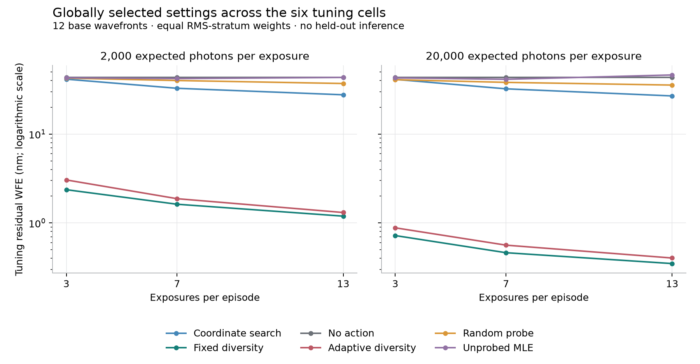

# Classical reference selection under photon budgets

The completed v1 tuning study selects a 20 nm random-probe amplitude, a 40 nm initial
coordinate-search step, and an 80 nm defocus probe for both fixed and adaptive diversity.
These are four choices within the declared coarse grids. No action and unprobed
maximum-likelihood estimation remain fixed controls. The
[full effective settings](../results/classical-selection-v1-20261016/selected-settings.json)
freeze all six families, including their common solver and command parameters.

The study contains **4,032 episodes and 30,912 measured exposures**, generated from
**12 independent base wavefronts**. It is public tuning data on a static, monochromatic,
exactly matched six-mode simulation. Its losses are conditional on selection and do not
estimate held-out performance, physical telescope performance or population rankings.

## A common selection problem

The [prospective configuration](../configs/classical_selection_v1.json) specifies four
bases in each physical-RMS stratum: 10–25, 25–50 and 50–90 nm. All twelve generated
bases have two conjugate members. Each candidate receives two detector replicates per
member at 2,000 and 20,000 expected photons per exposure, with separate allowances of
3, 7 and 13 exposures. There are 288 episodes per candidate and 48 per candidate/cell.

The optical model uses 32 pupil pixels per side, oversampling 2, a wavelength of 550 nm,
1 electron of Gaussian read noise and a 200 nm OPD bound per commanded mode. Each
exposure stores a signed 64-by-64 detector array. The twelve bases, their conjugates and
all declared exclusions are retained in the
[preparation record](../results/classical-selection-v1-20261016/preparation.json).

The selection criterion averages final residual wavefront error over detector replicates
within member, members within base, bases within RMS stratum, strata within cell, then
the six cells. One candidate per family minimizes this global loss. The unrounded loss
and candidate ID determine the choice; displayed rounding does not participate. The
[protocol](parameter-selection.md) records the candidate grid, paired random streams,
failure treatment and exact tie rule.

## Every candidate

| Family | Active parameter (nm OPD) | Global tuning WFE (nm) | Selected |
| --- | ---: | ---: | :---: |
| No action | Fixed control | 43.440970 | Yes |
| Unprobed MLE | Fixed control | 43.160867 | Yes |
| Random probe | 20 | 39.051839 | Yes |
| Random probe | 40 | 39.554450 | |
| Random probe | 80 | 42.867778 | |
| Coordinate search | 20 | 34.412657 | |
| Coordinate search | 40 | 33.703874 | Yes |
| Coordinate search | 80 | 39.569072 | |
| Fixed diversity MLE | 40 | 1.184366 | |
| Fixed diversity MLE | 80 | 1.119232 | Yes |
| Fixed diversity MLE | 120 | 1.237284 | |
| Adaptive diversity MLE | 40 | 1.348410 | |
| Adaptive diversity MLE | 80 | 1.346605 | Yes |
| Adaptive diversity MLE | 120 | 1.440195 | |



The active parameter is random amplitude, initial coordinate step or defocus-probe
amplitude, depending on the family. The coordinate step floor remains 5 nm; each MLE
fit allows three starts and at most 200 iterations per start. Unused fields are retained
in each full policy configuration so later code cannot silently substitute new defaults.

The adaptive 40 and 80 nm candidates differ by only **0.001804 nm** in global tuning
loss. The exact rule selects 80 nm; this small separation does not establish a stable
optimum. All candidate values, including each cell, stratum, base, member and detector
replicate, remain in [selection.json](../results/classical-selection-v1-20261016/selection.json).

## What changes across measurement allowances



These curves apply the same global setting at every cell. They do not select a new
setting after observing a cell's result. Both axes retain their physical units; the WFE
axis is logarithmic. The connecting segments organize the separately acquired budget
points and do not represent a continuously observed trajectory.

| Expected photons per exposure | Exposures | Fixed 80 nm: WFE (nm) | Adaptive 80 nm: WFE (nm) |
| ---: | ---: | ---: | ---: |
| 2,000 | 3 | 2.366236 | 3.047174 |
| 2,000 | 7 | 1.623657 | 1.874751 |
| 2,000 | 13 | 1.192810 | 1.310510 |
| 20,000 | 3 | 0.721035 | 0.881495 |
| 20,000 | 7 | 0.462534 | 0.562620 |
| 20,000 | 13 | 0.349121 | 0.403081 |

The specified fixed-diversity schedule has lower aggregate tuning WFE than the specified
adaptive schedule in all six cells. Its global mean is 1.119232 nm, compared with
1.346605 nm for adaptive diversity. This supports retaining a strong fixed baseline for
reserved evaluation. It does not isolate the causal effect of adaptation or establish
general superiority. At 2,000 photons and 13 exposures, base-level means favour each
schedule on six of the twelve bases, despite the lower aggregate fixed-diversity mean.

The unprobed estimator remains close to the no-action control in global loss. In the
20,000-photon, 13-exposure cell its mean is 46.249173 nm, above the no-action mean of
43.440970 nm. More unprobed exposures do not remove the even-mode sign ambiguity in
this optical model. Converged numerical optimization therefore does not by itself
establish an identifiable or useful correction.

Coordinate search improves as more modes can be visited, but completes only its first
six-mode sweep at 13 exposures. The smaller allowances are partial searches; step
halving is inactive throughout this grid. These curves do not characterize a fully
iterated coordinate optimizer.

## Numerical outcomes and accounting

The archive retains **6,912 multistart fit calls and 20,736 individual starts** across
all candidates. Every selected fit and every retained start reports finite convergence.
The recorded stopping conditions are projected-gradient tolerance for 3,781 starts and
relative-objective tolerance for 16,955 starts. There are zero numerical-fit fallbacks,
zero finite unconverged selected fits and zero affected episodes under the declared
failure definitions. These are observed counts for this run, not convergence guarantees
or evidence that the optimizer found global minima. The complete per-candidate counts
are in [fit-diagnostics.json](../results/classical-selection-v1-20261016/fit-diagnostics.json).

Fixed diversity and unprobed MLE use one fit per episode. Adaptive diversity fits after
successive observation prefixes, producing 2, 6 and 12 fits for the three allowances.
Equal exposure counts consequently do not imply equal computation. Recorded decision
times exclude camera simulation, artifact writing, verification and pauses; they are
not comparable algorithm latency measurements or real-time guarantees.

Every allowed exposure is charged, including repeated prefixes in separately acquired
budget episodes. At fixed photons per exposure, increasing the allowance increases the
total expected photons. Final commands can be scored by the evaluator without another
camera image; those final WFE values must not be presented as measured corrected images.

## Evidence and reproduction

The [reference packet](../results/classical-selection-v1-20261016/README.md) contains the
unchanged configuration, preparation, full summary, complete loss hierarchy, selected
settings and frozen source, with a separate manifest for the packet. The native archive
retains all 30,912 signed detector arrays and 4,032 episode records. Its manifest has
SHA-256 `95130d4d9bf5d534aa3bfc88bdaef5934b5862769061df2bb26c03cf72806ef0`.

Complete verification regenerated the declared cohort and case inventory, checked every
file, replayed detector draws and policy commands using the saved fits, and reproduced
the full summary and selection. A separate reduction checked every candidate loss and
all optimizer-start records. Verification did not rerun optimization. The frozen
source inventory is distinct from later package and verifier changes; the packet gives
its exact hashes and the corresponding public code revision.

Regenerate the figures from the retained reduction:

```sh
uv run --locked python scripts/plot_parameter_selection.py \
  --selection results/classical-selection-v1-20261016/selection.json \
  --output work/selection-figures
```

The [packet instructions](../results/classical-selection-v1-20261016/README.md) distinguish
compact consistency checks from full camera replay. Existing sequential ImageFolder
and HTML replay commands do not accept selection archives. This release does not claim
a working selection-specific dataset viewer or Hugging Face loader.

Twelve independent bases define the scope of this coarse tuning procedure. Conjugates,
noise replicates and shared budget prefixes add measurements, not independent
wavefronts. The reported means have no attached population confidence intervals,
significance tests or equivalence claims. Reserved evaluation, sample-size justification,
optical-model mismatch and real vision-model performance remain unestablished.
