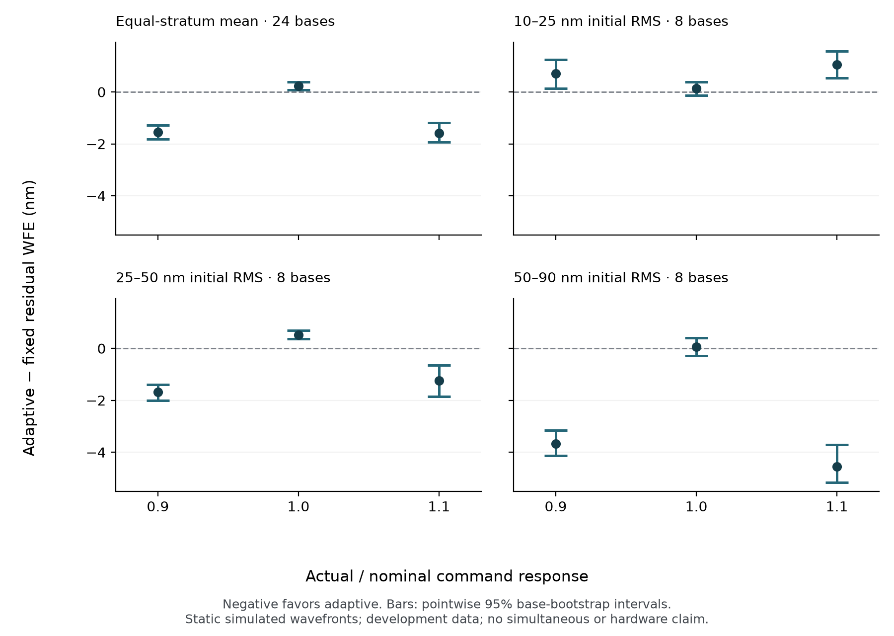

# Calibration mismatch changes the preferred measurement schedule

A measurement schedule that works well under correct calibration need not remain
the best choice when commands produce a different optical response. We compared
two frozen classical phase-diversity schedules under a constant scalar command
gain of 0.9, 1.0 and 1.1, using **288 episodes and 2,016 exposures from 24 independent
base wavefronts**. Each episode received seven exposures and 14,000 expected photons.

Adaptive probing reduced pooled residual wavefront error under both mismatched
gains. The benefit was concentrated at larger initial aberrations: **fixed
diversity performed better in the 10–25 nm stratum even with calibration error**.
Fixed diversity also had lower pooled error under correct calibration. These
results support testing calibration and aberration regime jointly, rather than
transferring a single matched-model ranking to every operating condition.

## Paired results

All values below are in nanometres of residual wavefront error (WFE). Negative
adaptive-minus-fixed differences favor adaptive probing. Brackets are pointwise
95% descriptive percentile intervals from 10,000 stratified base bootstrap
replicates; they are not simultaneous intervals or deployment acceptance tests.

| Actual / nominal command response | Fixed mean WFE | Adaptive mean WFE | Adaptive − fixed [interval] |
| ---: | ---: | ---: | ---: |
| 0.9 | 4.993 | 3.442 | −1.551 [−1.819, −1.279] |
| 1.0 | 1.687 | 1.920 | +0.233 [+0.081, +0.387] |
| 1.1 | 5.078 | 3.497 | −1.581 [−1.932, −1.190] |

The equal-stratum mean conceals a reversal at low initial WFE:

| Initial RMS stratum | Gain 0.9: adaptive − fixed | Gain 1.0: adaptive − fixed | Gain 1.1: adaptive − fixed |
| --- | ---: | ---: | ---: |
| 10–25 nm | +0.704 [+0.140, +1.240] | +0.129 [−0.132, +0.385] | +1.058 [+0.540, +1.570] |
| 25–50 nm | −1.688 [−2.012, −1.396] | +0.517 [+0.358, +0.693] | −1.247 [−1.850, −0.641] |
| 50–90 nm | −3.669 [−4.124, −3.154] | +0.052 [−0.279, +0.398] | −4.554 [−5.165, −3.704] |

Both schedules degraded relative to unit gain. At gains 0.9 and 1.1, the pooled
fixed-schedule penalties were 3.306 and 3.390 nm; the adaptive penalties were
1.522 and 1.577 nm. Adaptation reduced the pooled penalty without eliminating it.
The [complete analysis](../results/scalar-command-response-v1-20261028/analysis.json)
also retains absolute WFE, per-stratum penalties and paired differences in those
penalties, without averaging the two mismatched gains together.

## What was held fixed

The [protocol](scalar-gain-study.md) uses eight independent bases in each of three
finite-pupil RMS strata and both conjugates of each base. Every member is evaluated
at all three gains with both schedules. The fixed and adaptive 80 nm probe
settings came from the earlier [classical selection study](parameter-selection-results.md);
they were not retuned on these outcomes. A reviewed exclusion inventory separates
this cohort from previously exposed wavefronts and physical conjugate orbits.

The simulator uses six low-order OPD modes, a 32-pixel circular pupil, 2× Fourier
oversampling, 550 nm wavelength, Poisson photoelectrons and 1-electron Gaussian
read noise. A requested coefficient vector \(u\) produces \(g u\), so the residual
phase is derived from \(B(a-g u)\), where \(a\) is the incident aberration and
\(B\) is the sampled modal basis. WFE is computed on that finite pupil with piston
removed, not by treating sampled modes as exactly orthogonal.

The estimator receives nominal unit-response calibration and acquired camera
images. True gain and physical truth belong to the evaluator. Gain is constant
throughout each static episode. This tests command-to-phase response; it does
not change sensor optical gain, disturbance dynamics, actuator coupling or
misregistration. A final submitted correction is evaluator-scored without an
additional camera exposure.

Detector and policy streams are paired by base, conjugate member and replicate.
Shared seeds do not imply identical realized noise under different image
distributions. Analysis averages conjugates within each base, then resamples
whole gain/arm curves within each stratum. Neither frames nor conjugates count
as independent bases. There is one detector replicate and eight bases per stratum.

## Numerical outcomes and verification

All **288 episodes** submitted finite final corrections. The retained records
contain **1,008 fits**: 144 for fixed diversity and 864 for adaptive diversity.
Every fit was finite and reported optimizer success; no numerical fallback was
used. These are observed solver statuses, not evidence of global optimality.
Adaptive refits observation prefixes 2–7, whereas fixed diversity fits once.
The photon and exposure budgets match; the computational budgets do not.

The production verifier checked the exact artifact inventory, hashes, frozen
admission, source/runtime bindings, cohort, retained policy commands, deterministic
camera replay and complete reductions. It replays the retained fitted path rather
than rerunning optimization.

A separate [audit implementation](../scripts/audit_scalar_gain.py), with no
ProbeBench imports, reconstructs the finite-pupil basis, physical WFE, paired
aggregation and bootstrap intervals. Its [receipt](../results/scalar-command-response-v1-20261028/independent-audit.json)
binds the same raw manifest. This complementary audit does not independently
replay camera noise, refit estimators, verify Strehl or regenerate historical
exclusions. The [release packet](../results/scalar-command-response-v1-20261028/README.md)
provides raw data, exact hashes and reproduction instructions.

## Implications for autonomous calibration

A nominal-model score alone is insufficient to choose a measurement schedule
across the conditions tested here. A practical selector would need evidence about
its operating regime and should retain the option to withhold a recommendation
when that evidence is insufficient. The RMS strata in this analysis come from
simulator truth; they are not an available online selector input.

Testing such a selector requires a new prospective protocol, observable inputs,
separate selection and evaluation cohorts, and a declared cost for additional
calibration measurements. Choosing a schedule retrospectively from these strata
would not establish its performance. The present result is a completed descriptive
development study, not held-out controller superiority or hardware qualification.

## Citation

Noether Labs. *Calibration mismatch changes the preferred measurement schedule.*
2026. [https://github.com/noetherlabs/probebench](https://github.com/noetherlabs/probebench).
Use the versioned [data release](https://github.com/noetherlabs/probebench/releases/tag/scalar-command-response-v1-20261028)
when citing these measurements.
