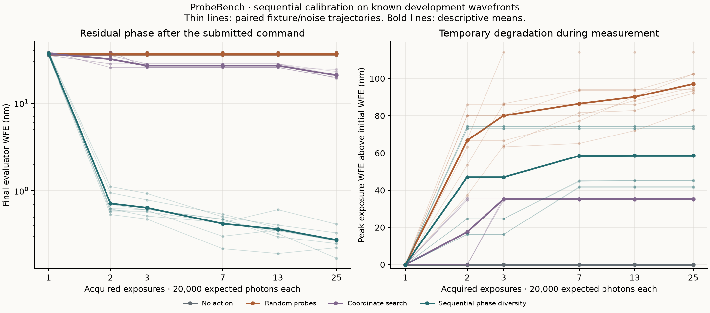

# ProbeBench: measurements before corrections

Noether Labs · 2026 · Development experiment

A focal-plane image can be compatible with more than one wavefront. For a symmetric
pupil, opposite defocus produces the same noiseless intensity. A controller that must
choose a correction from that image alone has an information problem before it has an
optimization problem.

ProbeBench makes the next measurement part of the task. A policy can apply a known
optical-path offset, acquire another noisy image, and use the change to infer the
incident phase. That probe consumes photons and can temporarily make the wavefront
worse. Both the information gained and the degradation incurred belong in the record.

## The experiment

We retained 192 episodes spanning four classical policies, four known mixed-mode
wavefronts, two detector replicates and six exposure allowances. Each exposure has
20,000 expected incident photons and 1-electron Gaussian read noise. The largest
allowance, 25 exposures, therefore costs 500,000 expected photons per episode.

The circular pupil uses 32 pixels across its sampling grid, Fourier propagation with
twofold padding, and a wavelength of 550 nm. Six piston-removed, individually
RMS-normalized modes represent defocus, two astigmatisms, two comas and spherical
aberration. The estimator and simulated plant share this calibration exactly.



The sequential phase-diversity reference reached a mean final residual WFE of
0.7131 nm with two exposures and 0.2736 nm with 25. At 25 exposures, coordinate search
reached 20.8943 nm; random probing and no action both remained at 36.8782 nm. The random
reference selected its initial zero-command image in every retained episode. These
are results for the declared configurations, not claims about optimally tuned search.

Coordinate search completes its first six-mode sweep at 13 exposures and its second
at 25. Its step sizes are 40 nm and 20 nm respectively. The phase-diversity reference
instead fits the calibrated Poisson–Gaussian image likelihood after known defocus
probes. This comparison includes differences in available model information, inference
and measurement selection; it does not isolate one factor.

## What the final error leaves out

At 25 exposures, phase diversity incurred a mean peak WFE increase of 58.5810 nm above
the initial wavefront during measurement. Its small final residual does not erase
that temporary cost. The archive contains every acquired image and evaluator state.

More measurements did not improve every individual estimate. Five of the 40 adjacent
budget comparisons for phase diversity increased final WFE. For example, one retained
trajectory increased from 0.4304 nm at seven exposures to 0.6073 nm at thirteen.
Those outcomes remain in the figure and [case-level audit](../results/sequential-analysis-20261014/solver-and-nonmonotonicity.json).

Forty final submissions were not camera-observed. Their reported WFE and Strehl are
computed by the simulator's evaluator. The [offline replay](../results/sequential-replay-20261014/index.html)
shows only acquired frames and labels these final submissions separately.

## Evidence and limits

All 1,632 exposures are retained. All 360 selected fits and all 1,080 optimizer starts
reported convergence in this run. An independent check found exact image and command
agreement across 832 shared-prefix exposures. A deliberate stop after 36 completed
episodes preserved all 91 checkpoint files byte-for-byte through resumption.

The ImageFolder export loaded all 1,632 images offline with Hugging Face Datasets.
Every exported signed array matched its source measurement exactly, including the
2,679,554 negative samples produced by read noise. Export and loading instructions are
in the [artifact specification](artifact-formats.md).

These are public development fixtures, forming two conjugate-ambiguity pairs. They
are static and correlated across budgets, and the optical model is exactly matched.
The experiment does not establish population rankings, robustness to model mismatch,
multimodal-agent capability or telescope performance. It establishes a reproducible
measurement record for the implemented policies under explicit resource accounting.

The [complete generated table](../results/sequential-calibration-20261014/report.md),
[protocol](sequential-calibration.md), [source snapshot](../results/sequential-calibration-20261014/source/)
and [manifest](../results/sequential-calibration-20261014/manifest.json) accompany the result.

## Citation

```bibtex
@misc{noetherlabs2026probebench,
  title = {ProbeBench: Measurements Before Corrections},
  author = {{Noether Labs}},
  year = {2026},
  url = {https://www.noether.one},
  howpublished = {Development experiment; code and retained data at https://github.com/noetherlabs/probebench}
}
```
